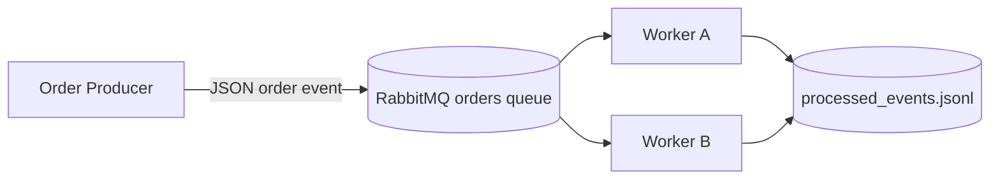

# CMPE 273 Module 5 Assignment

## Asynchronous Messaging with RabbitMQ

This project implements an asynchronous order pipeline. A producer publishes JSON order events to a durable RabbitMQ queue. Two independent workers consume from the same queue as competing consumers. Workers manually acknowledge messages only after processing, demonstrate redelivery after a crash before ACK, and use a shared append-only event store to make business processing idempotent.

## Architecture



RabbitMQ delivers each ready message to one worker at a time. With `prefetch_count=1`, each worker holds at most one unacknowledged message. If a worker connection closes before ACK, RabbitMQ requeues the message and another worker can receive it. The shared event store records `event_id` values before the business action, so a redelivered event is recognized and skipped.

## Requirements covered

- Producer publishes `event_id`, `order_id`, `item_id`, and `quantity`.
- Producer and workers run as independent processes.
- Two workers consume from one durable queue.
- Workers ACK only after processing finishes.
- A worker can intentionally exit before ACK for a selected event.
- RabbitMQ redelivers the unacknowledged message.
- Duplicate `event_id` values do not repeat the business action.
- README, architecture diagram, logs/evidence instructions, and tests are included.

## Assignment checklist

| Requirement | Implementation/evidence |
|---|---|
| Order producer | `producer.py` publishes multiple JSON messages. |
| Required message fields | Every message contains `event_id`, `order_id`, `item_id`, and `quantity`. |
| Independent processes | Producer and each worker run in separate terminal processes. |
| Competing consumers | Worker A and Worker B consume the same durable `orders` queue. |
| Manual acknowledgement | Workers use `auto_ack=False` and ACK only after processing. |
| Failure/redelivery | Worker A exits before ACK; RabbitMQ redelivers the message to Worker B. |
| Duplicate handling | `processed_events.jsonl` stores event IDs and prevents repeated business actions. |

## Project files

| File | Purpose |
|---|---|
| `producer.py` | Publishes multiple persistent JSON order events. |
| `worker.py` | Competing consumer with manual ACK, crash simulation, and duplicate handling. |
| `messages.py` | Order schema validation and JSON encoding/decoding. |
| `event_store.py` | Cross-process append-only event ID store with file locking. |
| `rabbit_config.py` | RabbitMQ and queue configuration from environment variables. |
| `docker-compose.yml` | RabbitMQ 3.13 with management UI. |
| `tests/test_assignment.py` | Unit and concurrency tests that do not require RabbitMQ. |
| `evidence.md` | Required screenshot/log names and evidence checklist. |

## Prerequisites

- Python 3.10 or newer
- Docker Desktop running
- Git

## Setup

```bash
cd cmpe273-module5-asynchronous-messaging
python3 -m venv .venv
source .venv/bin/activate
python -m pip install --upgrade pip
python -m pip install -r requirements-dev.txt
```

Start RabbitMQ:

```bash
docker compose up -d
docker compose ps
```

RabbitMQ endpoints:

- AMQP: `127.0.0.1:5672`
- Management UI: http://localhost:15672
- Username: `cmpe273`
- Password: `cmpe273`

## Successful competing-consumer demonstration

Use four Terminal windows. Activate the virtual environment in each Python terminal.

### Terminal 1: Worker A

```bash
source .venv/bin/activate
python worker.py --name worker-A
```

### Terminal 2: Worker B

```bash
source .venv/bin/activate
python worker.py --name worker-B
```

### Terminal 3: Producer

```bash
source .venv/bin/activate
python producer.py --count 8
```

Expected output is distributed between the workers. Each event should show one `received` line and one `ACK` line from only one worker:

```text
[worker-A] received event_id=evt-a1 order_id=order-1 redelivered=False
[worker-A] processing event_id=evt-a1
[worker-A] business action complete event_id=evt-a1
[worker-A] ACK event_id=evt-a1
[worker-B] received event_id=evt-b2 order_id=order-2 redelivered=False
[worker-B] processing event_id=evt-b2
[worker-B] business action complete event_id=evt-b2
[worker-B] ACK event_id=evt-b2
```

This demonstrates competing consumers because both workers use the same `orders` queue, but RabbitMQ assigns each message to one consumer.

## Redelivery and duplicate-handling demonstration

Stop both workers with `Ctrl+C`, then clear the event store and queue:

```bash
rm -f processed_events.jsonl
docker compose exec rabbitmq rabbitmqctl purge_queue orders
```

Start Worker A with the crash flag first:

```bash
source .venv/bin/activate
python worker.py --name worker-A --crash-event evt-crash
```

After Worker A prints `listening`, publish the controlled event from a third terminal using the command below. Worker A will receive it and exit before ACK. Then start Worker B in a fourth terminal:

```bash
source .venv/bin/activate
python worker.py --name worker-B
```

Publish the controlled event:

```bash
source .venv/bin/activate
python - <<'PY'
from producer import connection
from messages import encode_order, make_order
from rabbit_config import QUEUE_NAME
import pika

order = make_order("evt-crash", "order-crash", "sku-123", 1)
with connection() as conn:
    ch = conn.channel()
    ch.queue_declare(queue=QUEUE_NAME, durable=True)
    ch.basic_publish(
        exchange="",
        routing_key=QUEUE_NAME,
        body=encode_order(order),
        properties=pika.BasicProperties(delivery_mode=pika.DeliveryMode.Persistent),
    )
print("published evt-crash")
PY
```

Worker A should log:

```text
[worker-A] received event_id=evt-crash order_id=order-crash redelivered=False
[worker-A] processing event_id=evt-crash
[worker-A] business action complete event_id=evt-crash
[worker-A] SIMULATED CRASH before ACK event_id=evt-crash
```

Because the message was unacknowledged, RabbitMQ requeues it. Worker B should then log:

```text
[worker-B] received event_id=evt-crash order_id=order-crash redelivered=True
[worker-B] duplicate detected event_id=evt-crash; business action skipped
```

Worker B ACKs the redelivered message. The business action is not repeated. This demonstrates failure/redelivery and idempotent duplicate handling.

## Captured evidence

The following screenshots were captured while running the commands above. They are stored in the `evidence/` directory.

| File | Evidence shown |
|---|---|
| [`01-rabbitmq-healthy.png`](evidence/01-rabbitmq-healthy.png) | RabbitMQ container is running and healthy. |
| [`02-producer-published-orders.png`](evidence/02-producer-published-orders.png) | Producer publishes multiple order events. |
| [`03-worker-1-processing.png`](evidence/03-worker-1-processing.png) | Worker 1 receives and acknowledges assigned messages. |
| [`04-worker-2-processing.png`](evidence/04-worker-2-processing.png) | Worker 2 receives different messages from the same queue. |
| [`05-controlled-event-published.png`](evidence/05-controlled-event-published.png) | Controlled `evt-crash` event is published. |
| [`06-worker-a-crash-before-ack.png`](evidence/06-worker-a-crash-before-ack.png) | Worker A processes the event and crashes before ACK. |
| [`07-worker-b-redelivery-duplicate.png`](evidence/07-worker-b-redelivery-duplicate.png) | Worker B receives `redelivered=True` and skips the duplicate business action. |

Together, screenshots 03–04 demonstrate competing consumers, while screenshots 05–07 demonstrate failure, RabbitMQ redelivery, and idempotent duplicate handling.

## Tests

```bash
source .venv/bin/activate
pytest -q
```

Expected result:

```text
5 passed
```

The tests cover JSON message validation, duplicate detection, and cross-process event claiming without requiring RabbitMQ.

## Reflection

A message can be delivered more than once because a consumer may finish the business action but crash, lose its connection, or fail before RabbitMQ receives the ACK. RabbitMQ then treats the message as unacknowledged and makes it available for redelivery. Idempotent handling uses a stable `event_id` to recognize that the business action has already been applied. The worker skips the duplicate but still acknowledges the message, preventing repeated orders, charges, or inventory changes.

## Cleanup

```bash
docker compose down
```
